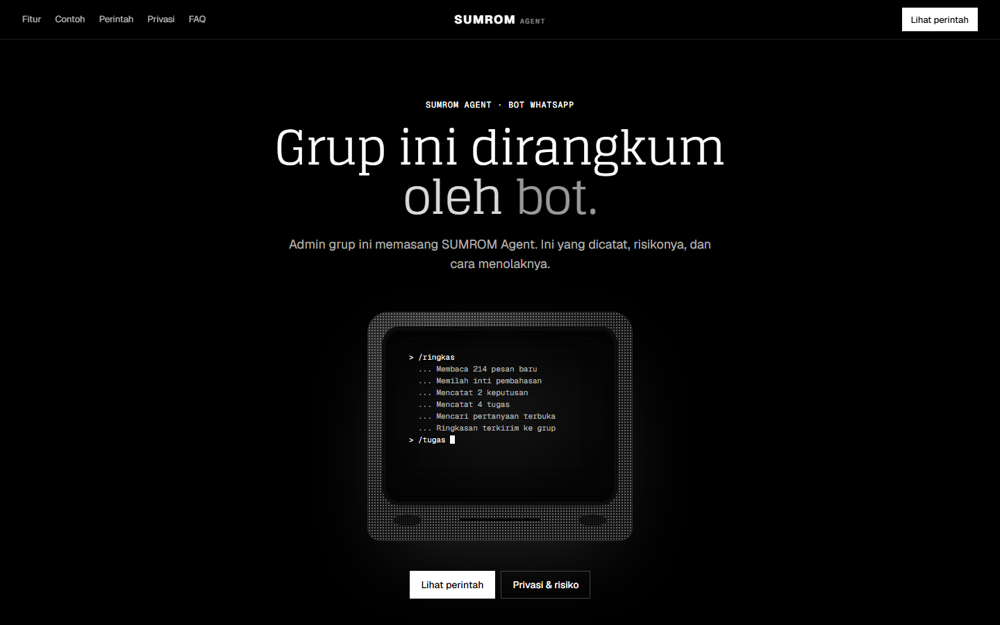
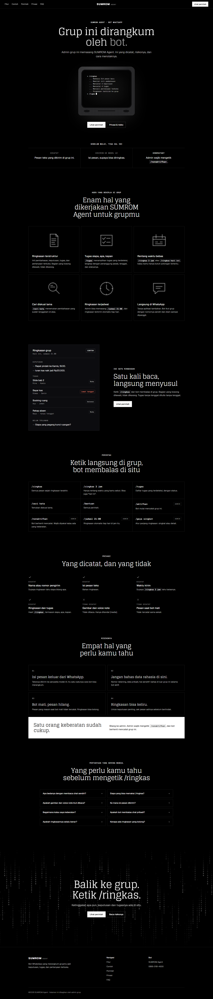
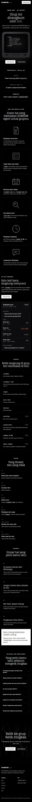

# SUMROM Agent

Bot WhatsApp yang merangkum percakapan grup. Bot ini berjalan di atas [Hermes Agent](https://hermes-agent.nousresearch.com).

Grup kelas, kerja, dan komunitas bisa menghasilkan ratusan pesan sehari. Keputusan, tugas, dan tenggat sering tenggelam di antaranya. SUMROM Agent bergabung ke grup dengan nomor terpisah dan menyimpan pesan teks. Saat ada yang mengetik `/ringkas`, atau sesuai jadwal, bot mengirim ringkasan terstruktur berisi:

- **Inti pembahasan**
- **Keputusan** yang diambil
- **Tugas** dengan format siapa, apa, kapan
- **Pertanyaan yang belum terjawab**

Bagian yang tidak ada isinya dilewati, tidak dikarang.



## Status

| Bagian | Status |
|---|---|
| Bot (plugin Hermes) | Berjalan di WhatsApp lewat Docker Compose, lihat [bot/](bot/) |
| Landing page | Selesai, di [landing/](landing/), di-deploy ke Vercel |
| Format pesan WhatsApp | Selesai, lihat [docs/format-pesan.md](docs/format-pesan.md) |
| Halaman panduan, dashboard admin | Direncanakan |

## Isi repository

```
.
├── bot/                    bot WhatsApp: plugin Hermes + Docker Compose
│   ├── plugins/sumrom/     kode plugin (perintah, penyimpanan, ringkasan, penjadwal)
│   └── tests/              tes plugin
├── landing/                landing page (Astro, statis)
│   ├── public/             favicon dan gambar pratinjau link
│   └── src/
│       ├── components/     satu komponen per bagian halaman
│       ├── data/           semua teks halaman (content.ts)
│       ├── layouts/        kerangka halaman dan meta
│       ├── pages/          beranda dan halaman 404
│       └── styles/         global.css
├── docs/
│   ├── format-pesan.md     format setiap pesan bot
│   └── screenshots/        tangkapan layar landing page
└── .impeccable/            konfigurasi alat desain
```

## Bot WhatsApp

Setup, uji coba, dan perintah operasional ada di [bot/README.md](bot/README.md). Singkatnya, dari folder `bot/`:

```bash
docker compose up -d              # nyalakan bot
docker compose restart hermes     # setelah mengubah kode plugin
docker compose logs -f hermes     # lihat log
```

Kode plugin dibaca langsung dari `bot/plugins/sumrom`, jadi perubahan kode cukup diikuti restart. Tidak perlu build image atau scan QR ulang.

Tes plugin (tanpa Docker):

```bash
cd bot
python -m unittest discover -s tests -v
```

## Perintah bot

| Perintah | Fungsi | Hak akses |
|---|---|---|
| `/ringkas` | Ringkas pesan sejak ringkasan terakhir | Semua anggota |
| `/ringkas 3 jam` / `/ringkas hari ini` | Ringkas rentang waktu tertentu | Semua anggota |
| `/tugas` | Daftar tugas yang terdeteksi | Semua anggota |
| `/cari kata` | Cari diskusi lama | Semua anggota |
| `/bantuan` | Daftar perintah | Semua anggota |
| `/idsaya` | Tampilkan ID WhatsApp pengirim (untuk mendaftarkan admin) | Semua anggota |
| `/aktifkan` / `/nonaktifkan` | Aktifkan atau matikan bot di grup | Admin |
| `/jadwal 21:00` / `/jadwal mati` | Atur atau matikan ringkasan otomatis | Admin |
| `/gaya singkat` / `/gaya detail` | Atur panjang ringkasan | Admin |

## Landing page

Landing page menjelaskan kepada anggota grup apa yang dicatat bot, apa risikonya, dan cara menolaknya. Link halaman ini dibagikan oleh admin di grup WhatsApp.

Tampilannya gelap dengan gaya terminal: judul serif Glegoo, teks Geist, label Geist Mono, layar CRT yang mengetik proses `/ringkas`, dan latar hujan angka biner di bagian penutup. Teks halaman diubah di `landing/src/data/content.ts`.

Butuh Node.js 18.20 ke atas. Semua perintah dijalankan dari folder `landing/`:

```bash
cd landing
npm install
npm run dev       # server pengembangan di http://localhost:4321
npm run build     # hasil statis ke landing/dist
npm run preview   # lihat hasil build
```

| Desktop | HP |
|---|---|
|  |  |

### Deploy ke Vercel

1. Buka [vercel.com/new](https://vercel.com/new) dan impor repository ini dari GitHub.
2. Isi **Root Directory** dengan `landing`. Framework terdeteksi otomatis sebagai Astro.
3. Klik **Deploy**.

Alamat situs untuk pratinjau link WhatsApp (`og:image`, canonical) diambil otomatis dari domain produksi Vercel. Setelah deploy, salin link-nya ke `SUMROM_LANDING_URL` di `bot/.env`.

## Privasi

- Bot hanya bekerja di grup yang diaktifkan secara eksplisit oleh admin, dan anggota grup diberi tahu.
- Pesan mentah dihapus otomatis setelah beberapa hari.
- Isi pesan dikirim ke penyedia model AI untuk diringkas.
- Jika ada anggota yang keberatan, admin wajib menonaktifkan bot dengan `/nonaktifkan`.
- API key disimpan di `bot/.env`, dan data Hermes (sesi WhatsApp, database) di Docker volume `sumrom-hermes-data`. Keduanya **tidak boleh** di-commit ke repository ini.

## Teknologi

- **Agen:** Hermes Agent (Nous Research, MIT)
- **WhatsApp:** bridge bawaan Hermes (Baileys), dengan nomor bot terpisah
- **Database:** SQLite
- **Deployment:** Docker Compose
- **Landing page:** Astro, di-host di Vercel
